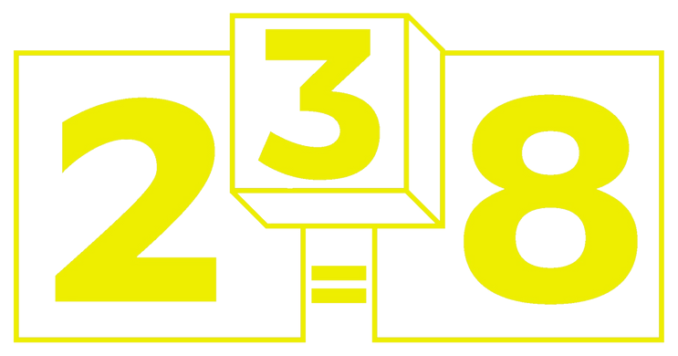

<header class="pit-topbar" markdown="span">
[← Go back to main page!](./){: .pit-back }
[{ .pit-brand__logo }](./){: .pit-brand }
**MMHS FRC 238 Operations**{: .pit-location .pit-location--end }
</header>

<main class="pit-content" markdown="1">

MMHS FRC 238 Operations
{ .pit-kicker }

# Our Team { .pit-title }

Students and mentors building skills, robots, and community.
{ .pit-lede }

<section class="pit-facts" aria-label="Team quick facts" markdown="1">
- **Date founded**
  1992
- **Team size**
  Mentors and students
- **Home**
  Memorial High School
</section>

<section class="pit-panel" markdown="1">
## What we do

We use STEAM and project-based learning to work together and compete in
*FIRST*&reg; Robotics competitions.
</section>

<section class="pit-panel" markdown="1">
## Proud to have women in STEAM

With 6 women on the team, two are team leads. We are committed to making
robotics a place where every student can lead, build, and innovate.
</section>

<section class="pit-panel" markdown="1">
## Also known as

Team 238, FRC 238, Crusaders, MMHS Crusaders, Team 238 Crusaders, FRC Team 238,
*FIRST* Team 238, Memorial Robotics, and Memorial High School Robotics Team.

**#frc238**{: .pit-hashtags } &nbsp; **#crusaders**{: .pit-hashtags }
</section>

</main>

<footer class="pit-footer" markdown="1">
*FIRST*&reg; Robotics Team 238

MMHS FRC 238 Operations
</footer>

